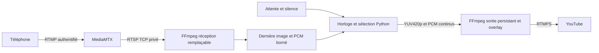

# Architecture et continuité

## Contrat de sortie indépendant du téléphone

MediaMTX authentifie et distribue les flux ; il ne fabrique pas une vidéo continue
lorsqu’un téléphone disparaît. Une entrée RTSP FFmpeg absente peut bloquer ou
terminer. Relancer l’encodeur à chaque basculement fermerait la connexion YouTube.

Le contrôleur fournit une trame YUV420p et 48 000/FPS échantillons PCM stéréo par
tick d’horloge monotone. Les deux pipes sont alimentés par des threads indépendants.
L’encodeur reconstruit les timestamps à partir des compteurs de trames/échantillons,
ajoute l’overlay et produit une seule sortie H.264/AAC.

## Réception et sélection

Le superviseur utilise ffprobe avec un timeout pour vérifier les pistes présentes.
Il lance un décodeur avec sortie vidéo normalisée par scale/pad/setsar/fps et,
si une piste audio existe, PCM 48 kHz avec compensation de dérive modérée.
Sans piste audio, il omet cette sortie du décodeur et fournit lui-même le silence.

Les lecteurs conservent seulement la dernière image complète et une demi-seconde
de blocs audio. Chaque nouveau décodeur crée un état neuf. La publication seule
ne suffit pas à sélectionner le match : il faut `READY_FRAMES` images et une
dernière image plus récente que `STALE_SECONDS`.

- Démarrage : attente préchargée et silence.
- Image récente après préchauffage : match et audio disponible.
- Image périmée : attente et silence, sans EOF vers l’encodeur.
- Audio absent/périmé ou tampon vide : bloc silencieux de même longueur.
- Décodeur mort ou sans image depuis au moins huit secondes : fermeture et nouvelles sondes.

Les sondes sont espacées progressivement jusqu’à cinq secondes. La reprise peut
donc demander plusieurs secondes, auxquelles s’ajoutent le GOP et le décodage.

## Temps et synchronisation

Les données brutes de sortie ne transportent pas les PTS du téléphone. Une nouvelle
publication ne remet pas à zéro la timeline de l’encodeur. Les FPS autorisés divisent
exactement 48 000, donc chaque tick fournit un nombre entier d’échantillons.

La sélection de la dernière image et l’évacuation des anciens blocs audio bornent
la mémoire/latence ; elles peuvent produire des répétitions/suppressions d’images
ou de petites coupures audio. Ce mécanisme ne conserve pas l’alignement PTS des
pistes entrantes. L’alignement labial et sa dérive dépendent des tampons et du
téléphone : une validation sur plusieurs heures reste nécessaire.

Les files vers l’encodeur sont bornées à deux secondes. Les écritures partielles
sont gérées. Les feeders indépendants et l’analyse minimale des entrées brutes
évitent le blocage à l’ouverture des deux pipes.

## Pannes de sortie

Le contrôleur surveille la fin du processus, les erreurs de pipe, les files pleines
et l’avancement effectif de `out_time_us` FFmpeg. Une sortie bloquée est détruite
puis recréée avec un délai croissant jusqu’à 30 secondes, réinitialisé après une
minute stable. Un dépassement d’horloge supérieur à 500 ms provoque aussi une
reprise explicite ; il faut alors corriger la pression CPU.

Ces reprises sont des ruptures réelles : nouvelle connexion et nouvelle timeline.
Le contrôleur ne pilote pas l’API YouTube et ne peut pas rouvrir un événement clôturé.
Un redéploiement, un redémarrage de conteneur ou une panne réseau n’est pas transparent.

## Ressources et sécurité

1080p YUV420p : environ 3,1 Mo par image, soit 93 Mo/s par pipe vidéo à 30 FPS.
Les échanges bruts restent locaux au conteneur. La limite mémoire et les quotas
CPU doivent être vérifiés avec les autres applications du VPS.

Un seul port public initial. RTSP TCP sur le réseau Compose, API désactivée,
publication/lecture sur `live` par comptes distincts, remplacement d’un éditeur
actif interdit. Le relais utilise un UID non root, aucune capacité Linux, un
filesystem en lecture seule et un `/tmp` borné.

La CI construit et teste l’image avant publication sur Docker Hub. Aucun secret de diffusion n’est
copié à la construction. Les versions Python/MediaMTX sont fixées, mais les
paquets Debian de sécurité évoluent entre builds. Le digest Docker Hub identifie
exactement une livraison. Reconstruire et valider régulièrement les correctifs.

## Extensions

La [console web privée](web-console.md) génère le PNG RGBA dans un volume partagé,
rechargé par FFmpeg à 1 Hz sans redémarrage. Elle lit le statut JSON du relais
et exige une connexion Google avec une liste de comptes autorisés.
SRT peut remplacer RTMP à l’entrée MediaMTX sans modifier la lecture RTSP.
Le chronomètre automatique et la prévisualisation vidéo ne sont pas implémentés.
