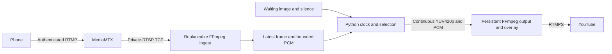

# Architecture and continuity

## Output contract independent of the phone

MediaMTX authenticates and distributes the streams; it does not produce a continuous
video when a phone disappears. A missing FFmpeg RTSP input can block or exit.
Restarting the encoder on every switch would close the YouTube connection.

The YouTube output stays closed when the relay starts. The console writes a
start/stop command tied to this instance's identifier into the shared volume.
A restart invalidates old commands. Stopping only closes the output; ingest stays
active and the healthcheck accepts this deliberate state.

During a requested broadcast, the controller supplies one YUV420p frame and 48,000/FPS
stereo PCM samples per tick of a monotonic clock. The two pipes are fed by separate
threads. The encoder rebuilds the timestamps from the frame/sample counters, adds the
overlay and produces a single H.264/AAC output.

## Ingest and selection

The supervisor uses ffprobe with a timeout to check which tracks are present.
It starts a decoder with a video output normalised by scale/pad/setsar/fps and, if an
audio track exists, 48 kHz PCM with moderate drift compensation.
Without an audio track, it omits that decoder output and supplies the silence itself.

The readers keep only the latest complete frame and half a second of audio blocks.
Each new decoder creates a fresh state. Publishing alone is not enough to select the
game: it takes `READY_FRAMES` frames and a latest frame newer than `STALE_SECONDS`.

- Start: preloaded waiting image and silence.
- Recent frame after warm-up: game and available audio.
- Stale frame: waiting image and silence, with no EOF towards the encoder.
- Missing/stale audio or empty buffer: silent block of the same length.
- Decoder dead or without a frame for at least eight seconds: closed, and new probes.

The probes are spaced out progressively up to five seconds. Recovery can therefore
take several seconds, plus the GOP and the decoding.

## Time and synchronisation

The raw output data does not carry the phone's PTS. A new publication does not reset
the encoder timeline. The allowed FPS values divide 48,000 exactly, so each tick
supplies a whole number of samples.

Picking the latest frame and dropping old audio blocks bound memory/latency; they can
cause repeated/dropped frames or small audio gaps. This mechanism does not keep the
PTS alignment of the incoming tracks. Lip sync and its drift depend on the buffers and
the phone: validation over several hours is still needed.

The queues towards the encoder are bounded to two seconds. Partial writes are handled.
The separate feeders and the minimal probing of the raw inputs avoid blocking when
both pipes are opened.

## Output failures

The controller watches for process exit, pipe errors, full queues and the actual
progress of FFmpeg's `out_time_us`. A stuck output is destroyed, then recreated with an
increasing delay up to 30 seconds, reset after one stable minute. A clock overrun of
more than 500 ms also triggers an explicit restart; the CPU pressure then needs fixing.

These restarts are real breaks: new connection and new timeline.
The controller does not drive the YouTube API and cannot reopen a closed event.
A redeployment, a container restart or a network outage is not transparent.

## Resources and security

1080p YUV420p: about 3.1 MB per frame, i.e. 93 MB/s per video pipe at 30 FPS.
The raw exchanges stay local to the container. The memory limit and the CPU quotas
must be checked alongside the other applications on the VPS.

A single public port initially. RTSP TCP on the Compose network, API disabled,
publish/read on `live` with separate accounts, replacing an active publisher is
forbidden. The relay uses a non-root UID, no Linux capabilities, a read-only
filesystem and a bounded `/tmp`.

CI builds and tests the image before publishing it to Docker Hub. No broadcast secret
is copied at build time. The Python/MediaMTX versions are pinned, but the Debian
security packages change between builds. The Docker Hub digest identifies exactly one
release. Rebuild and validate the fixes regularly.

## Extensions

The [private web console](web-console.md) generates the RGBA PNG in a shared volume,
loaded in the background only when it changes, then sent as YUVA420P at the same rate
as the video without a restart. It reads the relay's JSON status and requires a Google
login with a list of allowed accounts.
SRT can replace RTMP at the MediaMTX input without changing the RTSP reading.
The automatic game clock and the video preview are not implemented.
